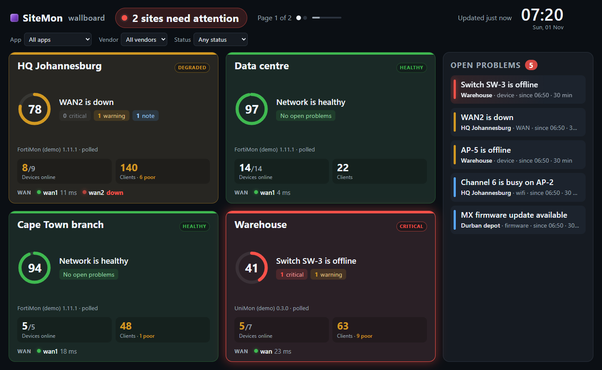
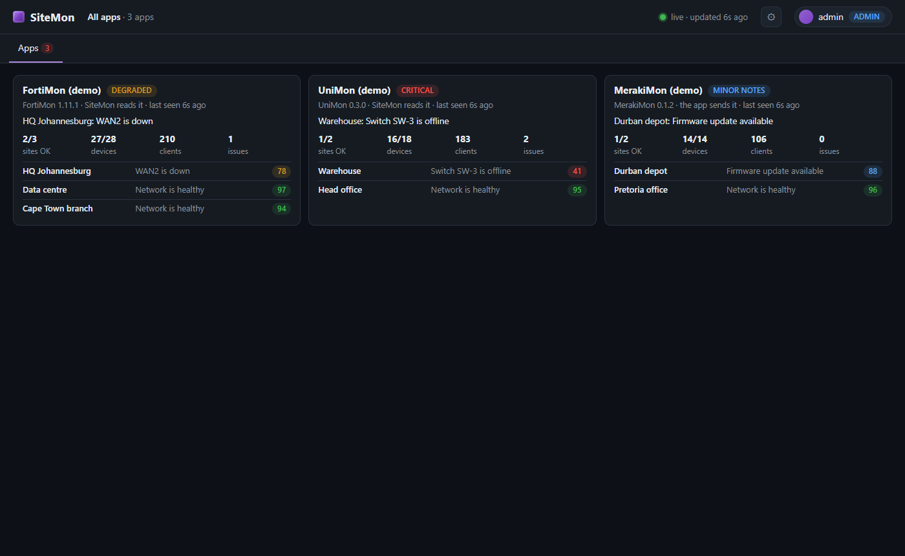

# SiteMon

**One wallboard across every MonStack app and site.** SiteMon shows FortiMon, UniMon and MerakiMon side by side: a tile per
site with its status, score and top problem, on a screen you can put on a wall. It never talks to network gear. It reads each
app's summary card, or receives it from an app it cannot reach. It runs on a server you run yourself, with no agents, no cloud
service of ours, and it is free to use.

SiteMon is part of [MonStack](https://github.com/RowShack/MonStack), a family of monitoring apps that share one look, one sign-in model and the same
signed updates.

## What it does

- **A wallboard** (`/wall`): a tile per site across all apps, refreshed every 30 seconds, with filters by app, vendor and
  status that stay in the address, so a TV can open `#status=critical`.
- **Pull or push.** SiteMon reads each app's card (`GET /api/card/v1`) every 30 seconds, or an app that SiteMon cannot reach
  pushes its card to SiteMon with an incoming key.
- **Honest about gaps.** An app that is offline, refused or unreadable keeps its last data on the screen, dimmed, with "last
  seen". The states are ok, connecting, offline, key refused, needs SiteMon update and unreadable card.
- **Trusted by certificate.** An https app is trusted by its certificate: **Test** shows the fingerprint before any key is
  sent, and later connections must show the same one.
- **Alerts** to email, Teams or a webhook: an app offline, key refused or unreadable, and back again; a site going critical,
  degraded or minor, and back to healthy. One alert per change, not per read.
- **A stored last state.** The last card and a short status history per site are kept, so a restart shows data straight
  away.
- **Users with roles**, two-step sign-in, backup and restore, signed in-app updates.
- **Its own card** at `GET /api/card/v1`, one entry per monitored app, so another SiteMon can read it.
- **Demo mode** with three stub apps (a FortiMon, a UniMon and a MerakiMon card).

Not verified yet: three real apps side by side, a push app going offline live, email and Teams destinations, and a rollback
with a broken release.

The screenshots are from SiteMon's demo mode (stub apps), so no customer data appears in them.

## Quick install

Download the files from the [latest release](https://github.com/RowShack/SiteMon/releases/latest).

- **Windows:** double-click `SiteMon-<version>.msi` and answer the questions (run as a service, who may connect, port).
- **Linux:** `sudo sh sitemon-<version>-linux.run` (systemd and Python 3.9 or newer).

Open `https://<server>:3443/`, create the first admin account, then add apps under **Settings > Apps**. The
[setup guide](docs/setup.md) covers the details, including making the key in each app.

## Documentation

- [Setup guide](docs/setup.md): install, make a card key in each app, add the apps, or let an app push.
- [Configuration reference](docs/configuration.md): Settings, the card, the data folder and the command line.
- [FAQ](docs/faq.md): common problems and questions.
- [Running it safely](docs/security.md): VPN or tailnet first, `trusted_proxies`, two-step sign-in, keys, what was checked.

## Help and feedback

- **Questions, bugs and ideas:** [open an issue](https://github.com/RowShack/SiteMon/issues/new/choose). Please give the version and
  your operating system, and never paste keys, passwords, configuration files or customer data.
- **Security problems:** please do not use public issues. See [SECURITY.md](SECURITY.md) to report them privately.
- The apps SiteMon shows and the overall picture: [MonStack](https://github.com/RowShack/MonStack).

## Licence

SiteMon is free to use and closed source. Read the [licence](LICENSE): you may install and use it, but not copy, sell, modify
or reverse engineer it.
